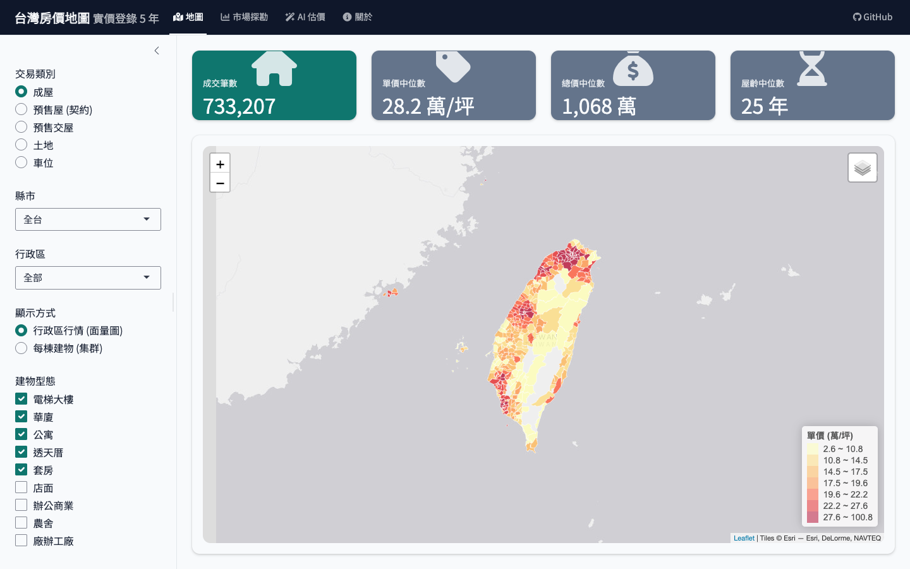
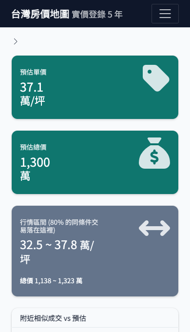
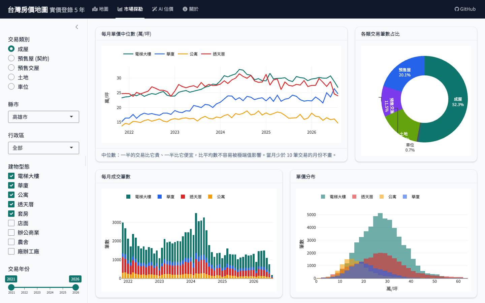

# 台灣房價地圖：實價登錄互動地圖與房價預測

**🌐 線上版：https://renture-data.shinyapps.io/taiwan-house-map/**

> 全台 5 年、169 萬筆不動產交易（成屋、預售屋、預售交屋、土地、車位）：自動化 ETL、免費離線地理編碼、互動式行情地圖、市場探勘圖表，以及附「價格區間」與「AI 複檢」的房價預測。

<p align="center">
  
  
</p>

## 功能

| 功能 | 說明 |
|---|---|
| 🗺️ 行情地圖 | 5 種交易類別；全台 → 縣市 → 行政區面量圖，選了行政區後顯示「每棟建物 / 每個建案」，點擊可以看交易明細 |
| 📊 市場探勘 | 單價趨勢、成交量、建物型態占比、單價分布、行政區排行、屋齡與單價 |
| 🤖 AI 估價 | XGBoost 預測單價與 P10–P90 行情區間；47 個特徵含交通（捷運、輕軌、台鐵、高鐵、機場、公車）、嫌惡設施、生活機能、附近行情、同棟歷史成交、臨路等級；可選屋況與產權條件（影響幅度由實價登錄備註量化）；列出附近相似成交，並產生 AI 複檢提示詞 |
| 🔄 自動更新 | GitHub Actions 每週：自動化測試 → ETL → 資料品質檢查 → 重新訓練 → 跳動檢查 → 部署 |

| 市場探勘 | AI 估價 |
|---|---|
|  |  |

## 架構

```
內政部實價登錄 (季資料 ZIP)
      │  new_All_data_ETL.R：下載、標準化、以季為單位增量寫入、保留最近 20 季
      ▼
PostgreSQL (schema re_v2)
  raw_trade ──SQL 清洗──▶ real_estate_clean ──▶ fact_residential_house / fact_presale_delivered / fact_land_only / fact_parking_only
  raw_presale ──SQL 清洗──▶ fact_presale_contract
  geo_cache ◀── new_geocode.R：OSM 道路 + 鄉鎮界線離線比對
      │
      ├─▶ new_model_training.R：基準 / 線性迴歸 / 隨機森林 / XGBoost + 分位數迴歸 + 保形校正
      └─▶ new_export_app_data.R：匯出精簡資料 (約 28MB)
                │
                ▼
          app/app.R (Shiny + bslib + Leaflet + Plotly) ──deploy_app.R──▶ shinyapps.io
```

## 資料管線成果

| 項目 | 數字 |
|---|---|
| 資料期間 | 110S4 ～ 115S3（2021-10 ～ 2026-09，共 20 季） |
| 原始交易 | a 檔（買賣）1,798,230 筆 + b 檔（預售屋契約）430,744 筆 |
| App 資料 | 1,686,026 筆：成屋 73 萬、預售屋 39 萬、土地 34 萬、預售交屋 21 萬、車位 1.9 萬 |
| 地理編碼 | 56.5 萬個地址，93% 精準到路段或巷弄；增量更新只處理新地址 |

## 模型成績

測試集是最近 6 個月的交易，模型訓練時完全沒看過（v3 模型，47 個特徵）：

| 模型 | MAPE | 誤差 ±10% 內 | 誤差 ±20% 內 |
|---|---|---|---|
| 基準：同區同型態中位數 | 24.5% | 25.9% | 49.9% |
| 線性迴歸（特徵價格模型） | 23.9% | 33.1% | 58.4% |
| 隨機森林 | 13.8% | 52.8% | 79.3% |
| **XGBoost（線上版）** | **12.0%** | **58.4%** | **84.0%** |

- 依建物型態：電梯大樓 **8.5%**、華廈 11.2%、公寓 15.8%、透天厝 17.5%。透天厝的價值大多在土地，面寬、臨路寬度等關鍵資訊實價登錄沒有記錄，是最難預測的型態。
- 價格區間：XGBoost 分位數迴歸 + 保形校正（Conformalized Quantile Regression），P10–P90 實際涵蓋率 **79.5%**（目標 80%）。
- 滾動回測（`new_model_backtest.R`）：模擬 4 個不同的上線時間點，v3 每一期都比 v2 準；用「以建物為單位的配對 bootstrap」算改進幅度的 95% 信賴區間，全部大於 0 → 改進不是運氣：

  | 上線時間點 | v2 MAPE | v3 MAPE | 改進（百分點） | 95% 信賴區間 |
  |---|---|---|---|---|
  | 2024-09 | 14.2% | 13.8% | 0.43 | 0.37 ～ 0.50 |
  | 2025-03 | 13.7% | 13.3% | 0.37 | 0.30 ～ 0.45 |
  | 2025-09 | 13.1% | 12.7% | 0.38 | 0.31 ～ 0.45 |
  | 2026-03 | 12.3% | 12.0% | 0.32 | 0.24 ～ 0.40 |

  預測 12 個月的誤差（12.8%）和 6 個月（12.7%）幾乎相同 → 每週重訓的頻率綽綽有餘。
- 誤差優化（v3）：每個想法都當成「實驗」，用同一個測試期回測、記錄在 `models/experiments.csv`，有效才放進正式模型（`experiments/`）：
  | 實驗 | 結果 | 採用 |
  |---|---|---|
  | 01 穩定性：多模型平均 | 重訓跳動 >10% 的房子 6.5% → 0.7%，但 MAPE +0.4pp | ✗（準確度優先，改用固定種子 + 固定資料順序 + 上線前跳動檢查） |
  | 02 同棟歷史成交（36 個月） | MAPE 12.5% → 12.2%；有同棟紀錄的透天 16.5% → 14.6% | ✓ |
  | 03 臨路等級（巷弄深度、OSM 道路等級、到主要道路距離） | 12.2% → 12.0%；弄內透天 16.0% → 14.7% | ✓ |
  | 04 附近地價（透天地坪價、同區住宅區土地） | 12.0% → 12.0%，透天略好、大樓略差 | ✗ |
- 模型監控：每週重訓後，拿上一版估過的 5,000 間房子重估一次，估價差距中位數超過 5% 就停止部署（`new_model_training.R` 第 11 節）。
- 屋況與產權：從實價登錄備註量化裝潢（+3%～+9%）、屋況不佳（−2%～−13%）、凶宅（約 −38%）的影響（`new_condition_adjust.R`）。

## 品質保證：測試、資料檢查、模型監控

| 機制 | 檢查什麼 | 失敗時 |
|---|---|---|
| 自動化測試（`tests/`，testthat 23 項；`python/tests/`，pytest 7 項） | 特徵函數的規則：不能偷看同月或未來的成交（防資料洩漏）、地址解析、時間窗邊界、和逐筆暴力計算的結果一致 | CI 第一步就停，不下載資料 |
| 資料品質檢查（`new_data_checks.R`，12 條規則） | 完整性（20 季、22 縣市、最新一季筆數）、唯一性、數值範圍、每個門牌都有座標與空間特徵；結果寫進 `re_v2.dq_results` | error 級：停止訓練與部署 |
| 跳動檢查（`new_model_training.R` §11） | 新模型重估上一版估過的 5,000 間房子，差距中位數 ≤ 5% | 停止部署，網站繼續用上週的模型 |

每個檢查都做過「反向測試」：故意植入資料洩漏 bug、故意弄壞資料（缺一季、重複匯入）、模擬模型異常，確認真的會擋下來。

## Python 版（`python/`）

核心模型（讀資料、特徵工程、XGBoost、評分）用 Python 重新實作，和 R 版逐項對照：

| | R | Python |
|---|---|---|
| 清理後筆數 | 763,087 | 763,087 |
| 基準模型 MAPE | 24.5% | 24.5% |
| XGBoost MAPE | 12.0% | 12.0% |
| 透天 / 大樓 / 華廈 / 公寓 | 17.5 / 8.5 / 11.2 / 15.8% | 17.5 / 8.4 / 11.2 / 15.9% |

工具對照：data.table rolling join ↔ `pandas.merge_asof`、RANN ↔ `scipy.cKDTree`、sf ↔ `geopandas`、testthat ↔ `pytest`。

```bash
cd python && python -m venv .venv && .venv/bin/pip install -r requirements.txt
.venv/bin/pytest -q          # 測試
.venv/bin/python train.py    # 訓練與評分（約 70 秒）
```

## 如何執行

```bash
# macOS 啟動 PostgreSQL（需指定語系，否則會啟動失敗）
LC_ALL=en_US.UTF-8 pg_ctl -D /Volumes/Dzzz_ssd/postgres_data -l /Volumes/Dzzz_ssd/postgres_data/logfile start
```

```r
source("new_All_data_ETL.R")      # 約 3 分鐘（第一次含下載）
source("new_geocode.R")           # 約 30 秒（第一次會下載約 260MB 的 OSM 圖資）
source("new_model_training.R")    # 約 20 分鐘
source("new_export_app_data.R")   # 約 1 分鐘
shiny::runApp("app")              # 本機預覽
source("deploy_app.R")            # 部署到 shinyapps.io（需先設定帳號，見檔案開頭說明）
```

路徑與資料庫連線設定集中在 `config.R`，可以用環境變數覆寫（GitHub Actions 就是這樣用的）。

## 關於我

**Renture** · 求職方向：**資料科學家 / 資料工程師**

這個作品涵蓋兩個角色的完整工作：
- **資料工程**：政府開放資料的自動化 ETL、PostgreSQL 分層資料模型、離線地理編碼、每週排程的 CI/CD、資料品質檢查
- **資料科學**：特徵工程（空間、時間、同棟歷史）、時間切分回測、實驗紀錄、分位數迴歸 + 保形校正、模型監控

開發過程、每個技術選擇的理由、遇過的錯誤與修正都記錄在 [學習筆記](docs/學習筆記.md)。

- GitHub：[xworking88111-source](https://github.com/xworking88111-source)
- Email：[xworking88111@gmail.com](mailto:xworking88111@gmail.com)

## 資料來源與授權

- 不動產成交資料：[內政部不動產交易實價查詢服務網](https://plvr.land.moi.gov.tw/)（政府資料開放授權條款）
- 道路圖資：© [OpenStreetMap](https://www.openstreetmap.org/copyright) contributors（ODbL），經 Geofabrik 下載
- 鄉鎮市區界線：內政部國土測繪中心，經 [taiwan-atlas](https://github.com/dkaoster/taiwan-atlas) 整理
- 底圖：Esri World Gray Canvas

估價結果僅供參考，不構成任何買賣或投資建議。

## 授權

- **程式碼**：[MIT License](LICENSE) © 2026 Renture。可以自由使用、修改、散布（包含商業用途），只要保留著作權聲明與授權條款。
- **資料**：程式碼的授權不包含資料。內政部實價登錄資料依「政府資料開放授權條款」、OpenStreetMap 資料依 ODbL 授權，使用時請依各自條款標示來源。

## 技術

R · Python (pandas, scikit-learn, geopandas) · PostgreSQL · SQL · sf (GIS) · XGBoost · ranger · Shiny · bslib · Leaflet · Plotly · testthat · pytest · GitHub Actions
